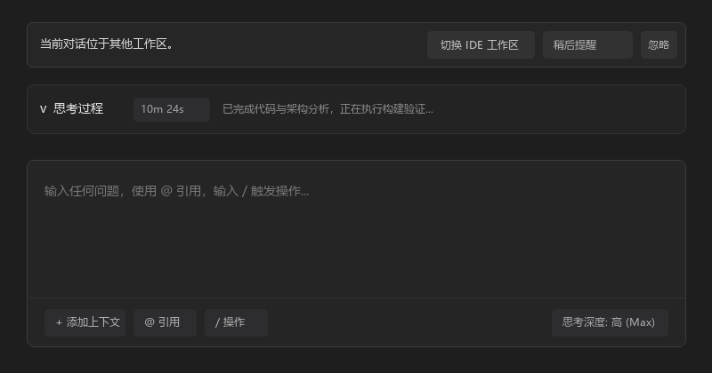
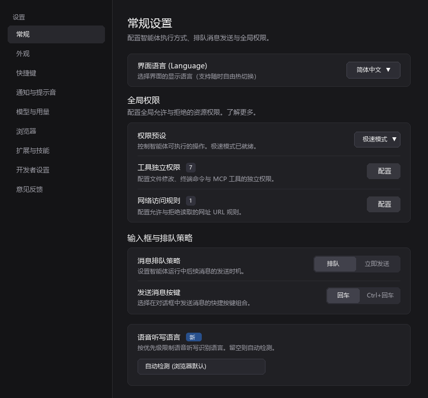
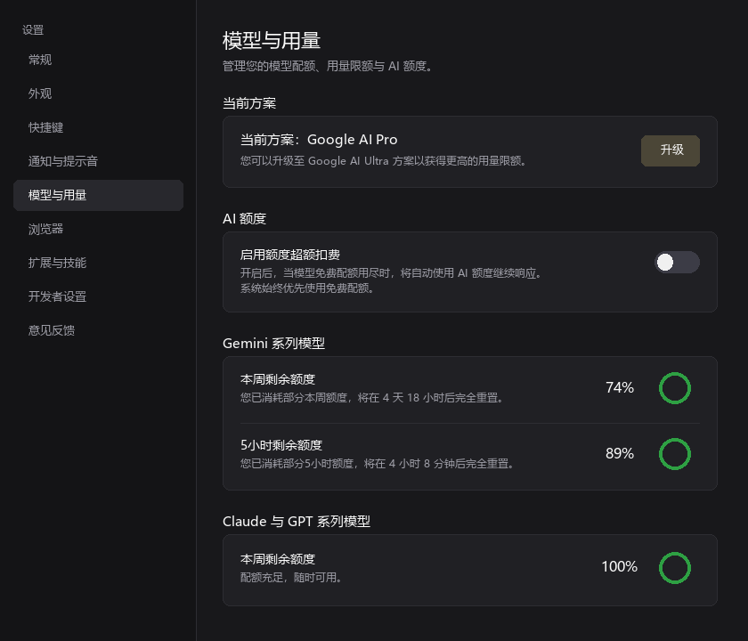
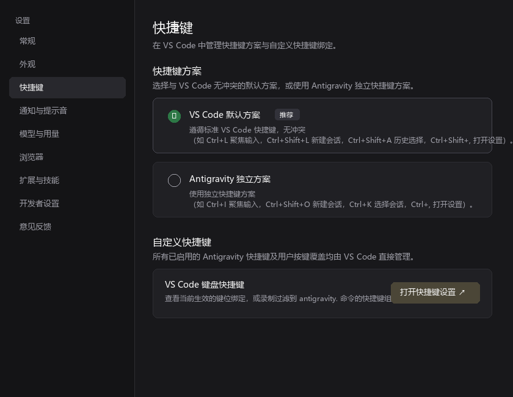
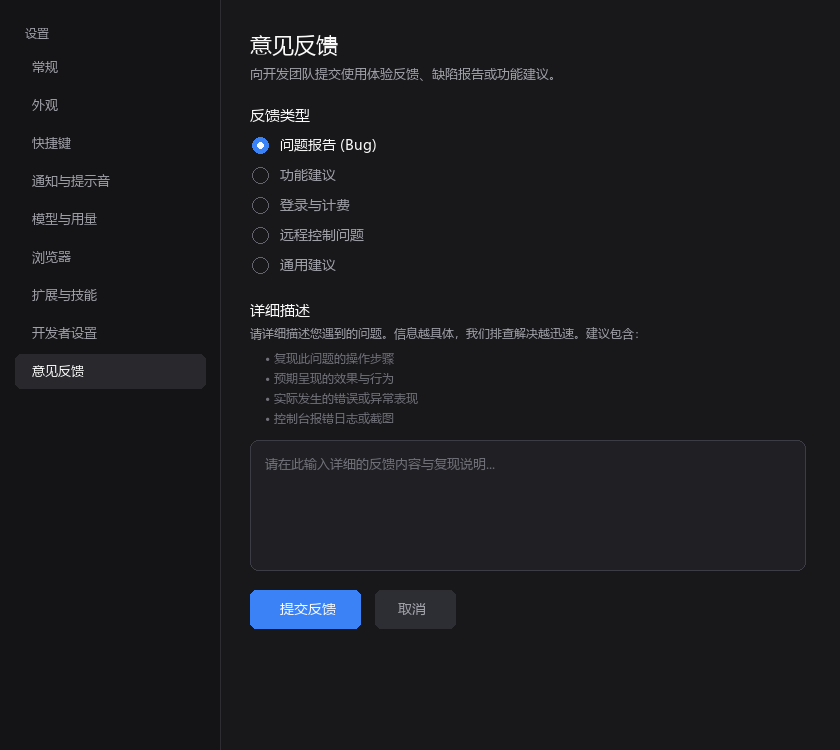

# Antigravity 本地化增强插件 (Chinese UI)

适用于开发工具的界面多语言增强与深度本地化脚本。

## 功能介绍
- **全界面深度本地化**：覆盖设置面板、模型管理、权限配置、快捷键、对话思考过程、跨工作区提示与输入操作栏等全量界面。
- **动态语言切换**：支持在插件设置菜单中即时切换显示语言（简体中文 / English），无需重装。
- **纯中文自然表述**：去除冗余的英文对照括号与生硬直译，贴合开发者日常习惯。
- **一键安装与还原**：提供图形化/批处理一键工具，自动备份官方原始文件，支持随时无损恢复。

## 界面展示
- **对话与输入区**:
  

- **常规与权限设置**:
  

- **模型与额度管理**:
  

- **快捷键定制方案**:
  

- **意见反馈对话框**:
  

## 使用方法
1. 双击运行 `汉化与语言管理.bat`，按提示选择 `[1] 安装 / 更新全界面深度汉化`。
2. 安装完成后在 VS Code 中按 `Ctrl+Shift+P`，输入并执行 `Developer: Reload Window`（重新加载窗口）即可生效。
3. 如需恢复原版英文，随时运行批处理选择 `[2] 恢复官方原始英文版本`。
